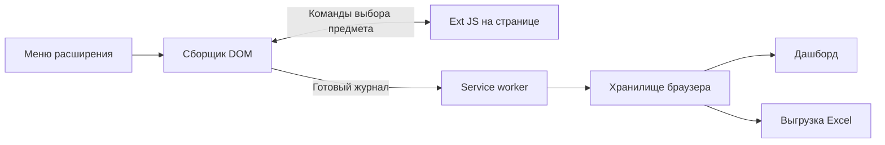

# Архитектура расширения

## Файлы и контексты выполнения

| Файл | Назначение |
| --- | --- |
| [`manifest.json`](../college-journal/manifest.json) | Manifest V3, всплывающее меню и фоновой service worker. Доступ запрашивается через `activeTab`, `scripting` и `storage`. |
| [`popup.js`](../college-journal/popup.js) | Запуск и остановка сбора, текущий прогресс, открытие дашборда и экспорт Excel. |
| [`collector.js`](../college-journal/collector.js) | Изолированный сценарий во вкладке колледжа. Проверяет DOM, читает таблицу, управляет обходом и отправляет результат на сохранение. |
| [`journal-page.js`](../college-journal/journal-page.js) | Сценарий в контексте страницы `MAIN`. Работает с Ext JS и не использует API расширения. |
| [`background.js`](../college-journal/background.js) | Service worker. Последовательно обрабатывает записи, сохраняет их и обновляет счётчик на значке. |
| [`dashboard.js`](../college-journal/dashboard.js) | Загружает сохранённые журналы и обновляет открытый дашборд по событиям `chrome.storage.onChanged`. |
| [`workbook.js`](../college-journal/workbook.js) | Формирует XLSX в браузере. В комплект входит JSZip и [его лицензия](../college-journal/JSZip-LICENSE.md). |

Скрипты запускаются по кнопке для активной вкладки. Для автосбора сначала внедряется `journal-page.js` в `MAIN`, затем `collector.js` в изолированный контекст. Два сценария обмениваются JSON-строками через события документа `college-journal-page-request` и `college-journal-page-response`. Ответ сопоставляется с запросом по `id`. Команды моста ограничены чтением состояния и списка, открытием и закрытием ComboBox выбором его записи и чтением или установкой диапазона дат в полях журнала. Вызов выбора запускает обычную загрузку сайта через пользовательский интерфейс.



## Автоматический обход одной группы

1. Сборщик фиксирует исходное видимое окно, выбранный период и подсказку группы при её наличии. Другие группы он не перебирает. Смена окна или периода и смена распознанной подсказки приводят к остановке.
2. Мост подписывается на события `beforerequest`, `requestcomplete` и `requestexception` объекта `Ext.Ajax`. В ожидании также проверяются видимые маски и признаки занятости компонента. Сборщик открывает ComboBox и ждёт раскрытый, непустой список. Если доступны узлы DataView, их количество должно совпадать с количеством записей. Многостраничный список и неоднозначные значения останавливают проход.
3. Если текущий предмет есть в списке, он обрабатывается первым. Для каждого следующего предмета сборщик фиксирует текущую сетку и первую правую строку, затем вызывает `onSelect` для записи ComboBox.
4. Сохранение возможно после совпадения выбранного значения и отображаемого текста, завершения отслеживаемых запросов и проверки новой сетки либо новой первой правой строки. Это закрывает промежуток, когда название предмета уже сменилось, а DOM ещё содержит предыдущую таблицу.
5. Полученный снимок должен оставаться одинаковым примерно **650 мс**. Проверка повторяется каждые **150 мс**. На ожидание списка или таблицы отводится по **60 секунд**. Сборщик отправляет `saveJournal` и ждёт подтверждения записи, прежде чем выбирать следующий предмет.
6. При ошибке или остановке пройденные журналы остаются в хранилище. «Остановить автосбор» прекращает выбор следующих предметов и ожидание. Уже начатая запись может завершиться. Чтобы возобновить обход, запустите его повторно.

Ручной режим проверяет DOM примерно каждые **350 мс**, ждёт стабильный снимок около **900 мс** и не пересохраняет идентичный снимок в рамках текущего запуска. Он приостанавливается при запуске автосбора. Полная перезагрузка вкладки завершает сеанс сбора. Сохранённые данные остаются в профиле.

## Даты, виды журналов и очистка

Дашборд передаёт диапазон при запуске автосбора. Сборщик устанавливает обе даты, проверяет значение полей и ждёт окончания загрузки перед сменой группы или выбором предмета. После смены группы он повторно проверяет даты. Ручная кнопка применяет тот же диапазон без запуска обхода. Тип активного журнала определяется по заголовку окна. Практические журналы имеют отдельный ключ и поле `kind: "practical"`. У прежних записей без `kind` тип считается теоретическим.

Очистка проходит в той же фоновой очереди, что и сохранение. Она обновляет отметку времени очистки и удаляет ключи `journal:…` и `catalog:…`. При изменении отметки активные сборщики останавливаются, а фоновый обработчик отклоняет позднюю запись от запуска, начатого до очистки. Настройка дат хранится отдельно.

## Запись и идентичность журнала

Пример записи с вымышленными значениями. Все ID студентов и занятий хранятся как строки.

```json
{
  "id": "<sha256>",
  "origin": "https://college.example",
  "period": "2026/2027",
  "group": "ГРУППА-0-00 - 1 курс",
  "subject": "Демонстрационный предмет",
  "students": [{"id": "90001", "number": "1", "name": "Учебный Пример"}],
  "lessons": [{"id": "99001", "number": "1", "date": "04.09", "label": "(1) - 04.09"}],
  "savedAt": "2026-11-21T17:30:00.000Z"
}
```

Ключ `journal:<sha256>` вычисляется из JSON-массива `[origin, period, subject, sortedStudentIds]`. При повторном чтении совпавшей записи список студентов обновляется, а занятия объединяются по ID. Такое объединение накапливает занятия и не удаляет ранее сохранённое занятие, если его больше нет в таблице. Изменение состава студентов создаёт отдельную запись. Группа служит подсказкой, может быть пустой и не входит в ключ. До версии 1.4.0 совпадение сайта, периода, названия предмета и состава объединяло журналы. При известной разной группе версия 1.4.0 сохраняет отдельную запись с ключом, учитывающим группу.

В дашборде счётчики уникальных студентов и занятий используют пару «сайт, ID». Таблицы показывают строки по журналам, поэтому один студент может встречаться в нескольких строках. Экспорт содержит три листа. Дата занятия сохраняется в исходном виде, без вычисления календарного года.
