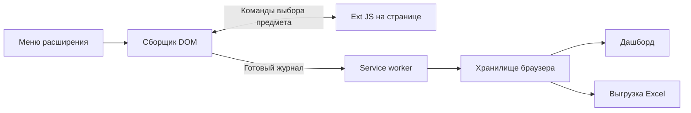

# Архитектура расширения

## Файлы и контексты выполнения

| Файл | Назначение |
| --- | --- |
| [`manifest.json`](../college-journal/manifest.json) | Manifest V3, всплывающее меню и фоновой service worker. Доступ запрашивается через `activeTab`, `scripting` и `storage`. |
| [`popup.js`](../college-journal/popup.js) | Запуск и остановка сбора, текущий прогресс, открытие дашборда и экспорт Excel. |
| [`collector.js`](../college-journal/collector.js) | Изолированный сценарий во вкладке колледжа. Проверяет DOM, читает таблицу, управляет обходом и отправляет результат на сохранение. |
| [`journal-page.js`](../college-journal/journal-page.js) | Сценарий в контексте страницы `MAIN`. Работает с Ext JS и не использует API расширения. |
| [`background.js`](../college-journal/background.js) | Service worker. Последовательно обрабатывает записи, сохраняет их и обновляет счётчик на значке. |
| [`dashboard.js`](../college-journal/dashboard.js) | Загружает сохранённые журналы и обновляет открытый дашборд по событиям `chrome.storage.onChanged`. |
| [`workbook.js`](../college-journal/workbook.js) | Формирует XLSX в браузере. В комплект входит JSZip и [его лицензия](../college-journal/JSZip-LICENSE.md). |

Скрипты запускаются по кнопке для активной вкладки. Для автосбора сначала внедряется `journal-page.js` в `MAIN`, затем `collector.js` в изолированный контекст. Два сценария обмениваются JSON-строками через события документа `college-journal-page-request` и `college-journal-page-response`. Ответ сопоставляется с запросом по `id`. Команды моста ограничены чтением состояния и списка, открытием и закрытием ComboBox выбором его записи и чтением или установкой диапазона дат в полях журнала. Вызов выбора запускает обычную загрузку сайта через пользовательский интерфейс.



## Автоматический обход одной группы

1. Сборщик фиксирует исходное видимое окно, выбранный период и подсказку группы при её наличии. Другие группы он не перебирает. Смена окна или периода и смена распознанной подсказки приводят к остановке.
2. Мост подписывается на события `beforerequest`, `requestcomplete` и `requestexception` объекта `Ext.Ajax`. В ожидании также проверяются видимые маски и признаки занятости компонента. Сборщик открывает ComboBox и ждёт раскрытый, непустой список. Если доступны узлы DataView, их количество должно совпадать с количеством записей. Многостраничный список и неоднозначные значения останавливают проход.
3. Если текущий предмет есть в списке, он обрабатывается первым. Для каждого следующего предмета сборщик фиксирует текущую сетку и первую правую строку, затем вызывает `onSelect` для записи ComboBox.
4. Сохранение возможно после совпадения выбранного значения и отображаемого текста, завершения отслеживаемых запросов и проверки новой сетки либо новой первой правой строки. Это закрывает промежуток, когда название предмета уже сменилось, а DOM ещё содержит предыдущую таблицу.
5. Полученный снимок должен оставаться одинаковым примерно **650 мс**. Проверка повторяется каждые **150 мс**. На ожидание списка или таблицы отводится по **60 секунд**. Сборщик отправляет `saveJournal` и ждёт подтверждения записи, прежде чем выбирать следующий предмет.
6. При ошибке или остановке пройденные журналы остаются в хранилище. «Остановить автосбор» прекращает выбор следующих предметов и ожидание. Уже начатая запись может завершиться. Чтобы возобновить обход, запустите его повторно.

Ручной режим проверяет DOM примерно каждые **350 мс**, ждёт стабильный снимок около **900 мс** и не пересохраняет идентичный снимок в рамках текущего запуска. Он приостанавливается при запуске автосбора. Полная перезагрузка вкладки завершает сеанс сбора. Сохранённые данные остаются в профиле.

## Даты, виды журналов и очистка

Дашборд передаёт диапазон при запуске автосбора. Пакетный сбор открывает теоретический и практический журналы через ярлыки рабочего стола или кнопки уже открытых окон. В каждом из них обрабатываются отмеченные группы. Ошибка в одном проходе отображается в итоговом статусе и не блокирует остальные проходы. Сборщик сверяет обе даты с диапазоном в каждом открытом окне. Для выбора фильтров достаточно готовности их полей и списка Ext JS. Глобальная маска может оставаться видимой даже при открытом списке из 202 групп. Перед сохранением таблицы проверяются занятость Ajax, маска и строки сетки. Если во время обхода предметов открылась соседняя вкладка, сборщик возвращает «Журнал» в том же окне. См. [наблюдения по ручному сеансу](reports/2026-11-22-journal-inspection.md). После смены группы он повторно проверяет даты. Ручная кнопка применяет тот же диапазон без запуска обхода. Тип активного журнала определяется по заголовку окна. Практические журналы имеют отдельный ключ и поле `kind: "practical"`. У прежних записей без `kind` тип считается теоретическим.

Очистка проходит в той же фоновой очереди, что и сохранение. Она обновляет отметку времени очистки и удаляет ключи `journal:…` и `catalog:…`. При изменении отметки активные сборщики останавливаются, а фоновый обработчик отклоняет позднюю запись от запуска, начатого до очистки. Настройка дат хранится отдельно.

## Запись и идентичность журнала

Пример записи с вымышленными значениями. Все ID студентов и занятий хранятся как строки.

```json
{
  "id": "<sha256>",
  "origin": "https://college.example",
  "period": "2026/2027",
  "group": "ГРУППА-0-00 - 1 курс",
  "subject": "Демонстрационный предмет",
  "students": [{"id": "90001", "number": "1", "name": "Учебный Пример"}],
  "lessons": [{"id": "99001", "number": "1", "date": "04.09", "label": "(1) - 04.09"}],
  "savedAt": "2026-11-21T17:30:00.000Z"
}
```

Ключ `journal:<sha256>` вычисляется из JSON-массива `[origin, period, subject, sortedStudentIds]`. При повторном чтении совпавшей записи список студентов обновляется, а занятия объединяются по ID. Такое объединение накапливает занятия и не удаляет ранее сохранённое занятие, если его больше нет в таблице. Изменение состава студентов создаёт отдельную запись. Группа служит подсказкой, может быть пустой и не входит в ключ. До версии 1.4.0 совпадение сайта, периода, названия предмета и состава объединяло журналы. При известной разной группе версия 1.4.0 сохраняет отдельную запись с ключом, учитывающим группу.

В дашборде счётчики уникальных студентов и занятий используют пару «сайт, ID». Таблицы показывают строки по журналам, поэтому один студент может встречаться в нескольких строках. Экспорт содержит три листа. Дата занятия сохраняется в исходном виде, без вычисления календарного года.


## План работы с занятиями

Файл `college-journal/lesson-workflow.js` реализует отдельную панель дашборда. Номер темы и подтверждения выполнения сохраняются в `chrome.storage.local` под ключами `workflow:plan:<journal-key>`, внутри по стабильным ID занятий. Код не отправляет мутаций в БАРС. Для навигации используется `chrome.scripting.executeScript`: в текущем журнале проверяются группа, дисциплина, тип журнала и ID занятия, затем нужная колонка выделяется. Никаких предположений о внутреннем имени компонента для сохранения оценки/привязки КТП/закрытия не делается. Кнопка очистки базы удаляет и планы.


## Изменения в занятиях (1.7.0)

`college-journal/lesson-actions-page.js` работает в `MAIN` и использует обработчики Ext JS открытой страницы для действий по отдельным занятиям. Из дашборда вызывается через `chrome.scripting.executeScript`. На каждом запуске сверяет URL origin, группу, предмет, тип журнала, ID/дату/номер занятия и ID студентов. Перед записью пользователь подтверждает изменение. Записываются только уникально определённые темы/пустые ячейки оценок, операции ждут сетевых событий сайта и отменяются при несовпадениях. Включены режим проверки без записи (`check`) и операции `bind`, `grades`, `close`; ни одно действие не формирует прямых HTTP-запросов. При ошибке страница сохраняет уже выполненные серверные изменения, поэтому повторный запуск должен быть идемпотентным и не перезаписывать другие оценки. Результат HTTP 200 не равнозначен подтверждённому статусу — UI показывает необходимость ручной проверки.


### Активация занятия по «Пос» (1.7.1)

В табличном заголовке БАРС два уровня: верхний `(№) - дата` и нижние заголовки колонок. У каждого занятия есть скрытая колонка с ID и видимая колонка `Пос`. Перед командами привязки КТП и закрытия вызывается `selectLesson(info)`, которая через `attendanceHeader(info)` ограничивает поиск «Пос» участком от скрытого ID выбранного занятия до скрытого ID следующего. Проверяется единственность результата. События `mousedown`, `mouseup`, `click` отправляются на `td.x-grid3-hd.x-grid3-cell` «Пос», а не на групповой заголовок. Регрессионный тест: `tests/lesson-attendance-header.cjs`.


## Фоновые операции и пакет КТП (1.8.0)

Дашборд использует `sourceTabId` и отправляет `chrome.scripting.executeScript` в исходную вкладку без её активации или переноса фокуса окна. Разрешение `host_permissions` ограничено сайтом колледжа. Модуль `lesson-batch.js` формирует очередь по № занятия; подтверждённые `linked`, ранее отправленные `bindAttempted` и неясные `bindNeedsReview` операции исключаются. Номер КТП обязателен для каждого нового задания. После каждого подтверждённого сетевого ответа сохраняется `bindAttempted`. Ошибка останавливает очередь на текущем занятии, чтобы не затронуть следующие; статус отмечается как требующий проверки. Нельзя считать сетевой HTTP-ответ подтверждением фактической привязки.


## Пакеты оценок и закрытия (1.9.0)

Модуль `lesson-batch.js` дополнен чистыми планировщиками `prepareGrades` и `prepareClose`. Первый исключает закрытые, подтверждённо оценённые и ранее отправленные/непроверенные занятия. Второй требует `linked && graded` для каждого незакрытого занятия и отдельно блокирует ситуации с предыдущей неясной попыткой закрытия. Сохранённые локальные признаки `gradeAttempted`, `gradeNeedsReview`, `closeAttempted`, `closeNeedsReview` препятствуют автоматическому повтору после прерывания. Перед исполнением каждого шага записывается защитная отметка, а после успешного выполнения — результат через `saveActionOutcome`. Пакет продолжает очередь **только после подтверждения** состояния (для оценок — чтение после `refresh_btn`, для закрытия — доступность штатных кнопок открытия/закрытия). При ошибке, остановке пользователем, отсутствии read-back или сбое локального сохранения дальнейшие действия не отправляются. Все операции работают через `chrome.scripting.executeScript` в исходной вкладке без изменения фокуса.


## Подтверждение закрытия на один шаг позже (1.9.1)

`lesson-actions-page.js` версии 3 разделяет `closeBatch` (выбор «Пос» и штатный `close_lesson_btn`, ожидание XHR без немедленной проверки) и `verifyClose` (только выбор занятия и проверка кнопок состояния). `verifyCloseFinal` дополнительно вызывает штатное обновление строк `refresh_btn` и снова проверяет состояние, не отправляя закрытие. `lesson-batch.js:runDelayedClose()` реализует последовательность `close(A), close(B), verify(A), close(C), verify(B), verifyFinal(C)`. Подтверждение сохраняется только при доступной кнопке открытия и недоступной кнопке закрытия для проверяемого занятия. Последняя запись может остаться в `closeNeedsReview` без повторной отправки. `resumableClose` допускает одно ранее отправленное закрытие с известным признаком ожидающего подтверждения перед первой новой датой; неизвестный результат сетевого сбоя или несколько неподтверждённых закрытий блокируют продолжение. Дашборд показывает число отправленных и отдельно подтверждённых занятий; ручная кнопка «Проверить закрытие» выполняет read-back без повторного закрытия.


## Заполнение журнала по датам (1.10.0)

Модуль `lesson-batch.js` содержит `lessonsByDate` (хронологическая сортировка дат с переходом учебного года и вторичной сортировкой по № занятия), `assignKtpSequence` (проверка начального № КТП и генерация +1), `prepareFull` (отклонение уже отправленных неопределённых записей) и `runFillDates` (конвейер стадий одного занятия с обновлением и отложенным подтверждением закрытия). Дашборд `lesson-workflow.js` добавляет действия `applySequentialKtp` и `runFullJournalByDates`, использует тот же безопасный `executeLessonOperation` в фоновой вкладке. Перед каждой записью выставляется локальная защита `bindAttempted`, `gradeAttempted` или `closeAttempted`, на ошибке дальнейшие занятия не обрабатываются. КТП не помечается подтверждённым только по HTTP-ответу; оценки проверяются повторным чтением; закрытие проверяется через `verifyCloseFinal` со штатным обновлением и затем (при необходимости) через `verifyClose` после следующего закрытия. Ранее обработанные занятия с несовместимыми номерами КТП не перенумеровываются.

## Избранные журналы и режим ошибок (1.11.0)

Состояние хранится в workflow:favorite-journals (массив устойчивых идентификаторов журналов, определяемых origin/period/group/subject/kind) и workflow:stop-on-errors (boolean, по умолчанию true). В lesson-workflow.js функции assignFavoriteKtp, runFavoriteJournalQueue и navigateQueueJournal позволяют подготовить номера тем, переключать локальные планы и выполнять каждый журнал последовательно.

Навигация работает в исходной вкладке через content script collector.js и main-world мост journal-page.js. Асинхронное сообщение navigateJournal использует существующие openJournal, openBatchGroup и pageCommand для выбора типа, группы и дисциплины. После выбора сверяет все ID планируемых занятий; при нехватке применяет соответствующий сохранённым датам диапазон через applyDates. Ошибка навигации блокирует запись в журнал.

В lesson-batch.js функция runFillDates поддерживает stopOnError:false. При неудачной стадии не выполняются оставшиеся серверные изменения этого занятия, но продолжается следующая дата. Несколько закрытий с запаздывающим подтверждением остаются в pendingLessons и могут быть проверены после более поздних закрытий. Фатальный сбой сохранения локальной защитной отметки прерывает работу даже при выключенном флажке. Отчёт очереди сохраняется в состоянии дашборда на время сеанса; список избранных и настройка ошибок сохраняются в chrome.storage.local. clearDashboard удаляет эти настройки.

## Контроль состояния, preflight и CI (1.12.0)

`lesson-actions-page.js` версии 4 добавляет действие `inspectRefresh` — штатное обновление, выбор занятия строго по ID, чтение явного номера темы КТП (при наличии), оценок и состояния команд открытия/закрытия. Непрозрачное состояние не конвертируется в успех. `lesson-reconcile.js` содержит чистые функции `reconcile` и `auditJournal`. Последняя сравнивает сохранённый план, студентов и ID занятий с реальным выбранным журналом, который `collector.js` возвращает после навигации.

`lesson-workflow.js` запускает preflight всей очереди до первой записи, сверку состояний и восстановление пропущенных безопасных этапов. Контрольная точка `workflow:queue-checkpoint` сохраняется через атомарный адаптер `queue-checkpoint.js`. При невозможности записи контрольной точки очередь останавливается. Состояние и результаты сохраняются при закрытии дашборда и включены в экспорт `catalog-db.json`.

Генератор КТП импортирует локальный файл `catalog-db.json`: выбирает дисциплину, создаёт строки групп/учебных периодов; специальность и код остаются ручными полями. GitHub Actions `.github/workflows/ci.yml` автоматически выполняет Node.js-проверки при каждом push в main и pull request. Дополнены поведенческие тесты `lesson-reconcile.cjs` и `queue-checkpoint.cjs`; прежние тесты сохраняются.

Ограничение: в исходном логе инспекции нет ответа с привязанной темой, а в предоставленном HTML её номер явно не виден. Строгая верификация КТП не может быть гарантирована на всех страницах БАРС без новой инспекции структуры реальной привязки; алгоритм не выводит номер из ответа HTTP 200.
